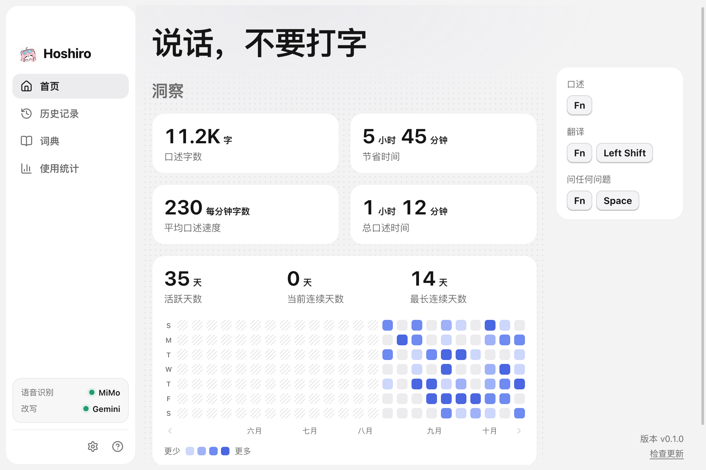
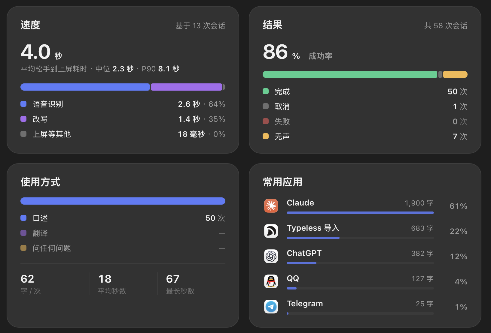

<p align="center"></p>

<h1 align="center">Hoshiro</h1>

<p align="center">基于 Tauri 2 的 macOS 语音输入法。按住快捷键说话，松开自动将润色后的文本插入光标处。</p>

<p align="center">
  <a href="../../releases/latest"></a>
  <a href="../../releases"></a>
  
  <a href="LICENSE"></a>
  <a href="https://app.fossa.com/projects/git%2Bgithub.com%2FIcyBlue17%2Fhoshiro?ref=badge_shield"></a>
</p>

<p align="center">
  
  
  
  
  <a href="../../stargazers"></a>
  <a href="../../commits/main"></a>
</p>

<p align="center"></p>

对标 [Typeless](https://www.typeless.com) 操作体验，支持直接导入 Typeless 的配置与历史记录。采用 Bring Your Own Key 模式，请求直连服务商，无中转服务器，所有数据本地存储。

## 特性

- **智能整理**：自动过滤语气词（“嗯、啊、那个”等）与停顿；支持改口修正（如“周三，不对，周四” → “周四”）；规范阿拉伯数字与中英文空格排版；支持长文本智能分段或列表化。
- **悬浮胶囊**：录音时底部展示实时波形，处理阶段显示进度动效，不抢占焦点、不遮挡工作区。
- **多模式输入**：
  - **口述**：按住快捷键说话，松开即插入；双击快捷键开启免提模式。
  - **翻译**：`Fn + Left Shift` 口述，直接输出目标语言。
  - **问答与改写**：`Fn + Space`。选中文本时就地改写替换，未选中文本时发起问答。
- **个性化学习**：自动学习常用专有名词、口癖与修改偏好，可随时查看或手动删除。
- **按应用用量统计**：记录各应用使用比例与字数，分段统计语音识别、大模型改写与上屏耗时（均值 / 中位数 / P90），所有指标均在本地计算。
- **隐私安全**：历史记录、录音与词典完全保存在本地；API 密钥存放在 macOS 钥匙串。

<p align="center"></p>

## 支持的服务

| 类别 | 服务商 |
|---|---|
| 语音识别 | 小米 MiMo（推荐中文）、Cloudflare Workers AI (Whisper)、Azure Speech（流式）、Google Cloud Speech（流式） |
| AI 润色 | Google Gemini、Anthropic Claude、Cloudflare Workers AI、OpenAI 兼容接口（内置 DeepSeek、OpenRouter、智谱、Kimi、百炼、Ollama 等预设） |

详细配置说明见[使用指南](docs/guide.md#服务商配置)。

## 常用快捷键

| 快捷键 | 功能 |
|---|---|
| 按住 `Fn` | 开始口述，松开后插入 |
| 双击 `Fn` | 免提模式，再次按 `Fn` 结束 |
| `Fn + Left Shift` | 语音翻译 |
| `Fn + Space` | 问答 / 选中文本改写 |
| `Esc` | 取消当前输入（支持短时间内撤销） |
| `Ctrl + ⌘ + V` | 重新粘贴上一条结果 |

> 快捷键可在设置中自定义，支持单一修饰键（如独立 `Fn`、右 `Option`）及组合键。

## 安装

从 [Releases](../../releases/latest) 下载 `.dmg` 文件：
- Apple Silicon (M 系列芯片)：下载 `aarch64` 版本
- Intel 芯片：下载 `x64` 版本

若首次打开提示“已损坏”或“无法验证开发者”，在终端运行：

```bash
xattr -cr /Applications/Hoshiro.app
```

## 快速上手

1. 打开应用，按引导授予**麦克风**、**辅助功能**、**输入监控**权限。
2. 前往「设置 › 模型服务」，填入语音识别与改写模型的 API Key。
3. 打开「系统设置 › 键盘」，将「按下 🌐 键时」设为「不执行任何操作」（避免与 `Fn` 触发冲突）。
4. 在任意输入框中按住 `Fn` 说话，松开后即可插入文本。

## 从 Typeless 迁移

在「设置 › 数据与迁移」中点击「从 Typeless 导入」，即可自动迁移快捷键、语言偏好和本地历史记录。

> Typeless 的词典存储在云端，无法直接读取。可将词汇整理为单列 CSV 文件，在「词典」页手动导入。

## 平台支持

| 平台 | 状态 |
|---|---|
| macOS 13+ | 正式支持 |
| Windows / Linux | 开发中 |

## 本地开发

本项目基于 Tauri 2 (Rust) + React 19 构建。环境要求、目录结构与开发规范见 [CONTRIBUTING.md](CONTRIBUTING.md)。

## 许可证

[MIT](LICENSE)

[](https://app.fossa.com/projects/git%2Bgithub.com%2FIcyBlue17%2Fhoshiro?ref=badge_large)

---

*Hoshiro 为独立开源项目，与 Typeless 及上述提及的第三方模型服务商无任何商业关联。*
