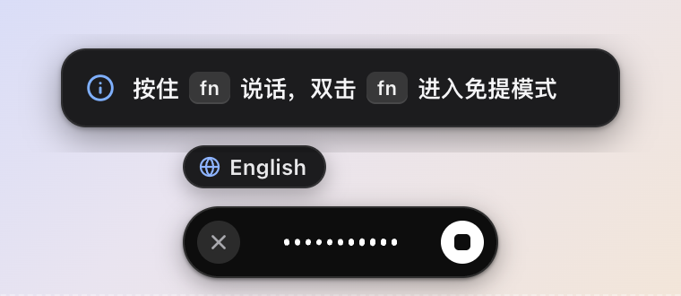
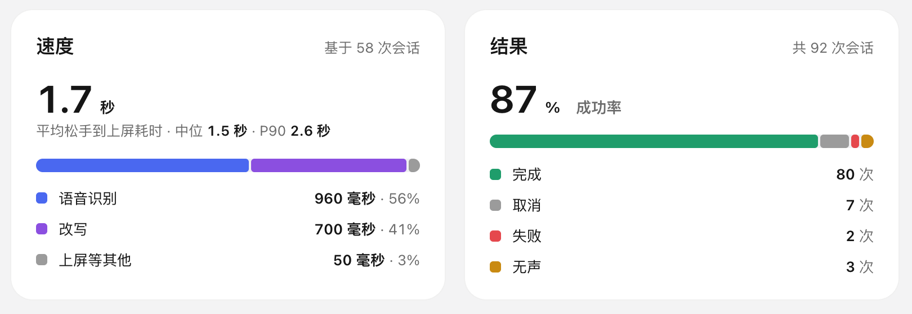

<p align="center"></p>

<h1 align="center">Hoshiro</h1>

<p align="center"><b>按住 Fn 说话，松开就是一段写好的字。</b></p>

<p align="center">
  <a href="../../releases/latest"></a>
  
  <a href="LICENSE"></a>
</p>

<p align="center"></p>

Hoshiro 是一个 macOS 语音输入工具：在任何能打字的地方按住 Fn 说话，松开后 AI 把你的口语整理成通顺的文字，直接插到光标处。

操作习惯和 [Typeless](https://www.typeless.com) 基本一致，老用户可以直接上手，设置和历史记录也能一键导入。语音识别和 AI 润色都用**你自己的 API Key**，请求直接发给你选的服务商，不经过任何中间服务器。

## 亮点

- **说完就是成稿**：自动去掉「嗯、啊、那个」，口误改口只留最终说法（“周三，不对，周四” → “周四”），数字写成 123，中英文之间自动加空格。
- **长段也能理顺**：一口气说一大段，可以按话题分段，也可以整理成 1. 2. 3.。
- **悬浮条**：录音时屏幕底部出现一条黑色小胶囊，白色波形跟着声音跳，处理时有扫光动画。

  &nbsp;&nbsp;

- **翻译**：`Fn + Left Shift` 说中文，直接出地道的英文（或别的语言）。
- **随便问**：`Fn + Space`，选中一段字说“改礼貌点”就地替换；不选就直接提问。
- **越用越懂你**：自动学习你的常用词、口癖和纠错习惯，学到什么都能看、能删。
- **使用统计**：字数、省下的时间、识别和改写各花多久、常用应用一目了然。

  

- **密钥放钥匙串**：API Key 存在 macOS 钥匙串里，不落明文。

## 支持的服务

| 用途 | 服务商 |
|---|---|
| 语音识别 | 小米 MiMo（推荐中文）、Cloudflare Workers AI（Whisper）、Azure Speech（流式）、Google Cloud Speech（流式） |
| AI 润色 | Google Gemini、Anthropic Claude、任何 OpenAI 兼容接口（OpenAI、OpenRouter、Vercel AI Gateway、DeepSeek……） |

各家怎么配，见 [使用说明](docs/guide.md#配置服务商)。

## 安装

到 [Releases](../../releases/latest) 下载 `.dmg`：Apple 芯片选 `aarch64`，Intel 选 `x64`，拖进「应用程序」即可。

> 安装包没有经过 Apple 公证，第一次打开如果提示“已损坏”或“无法验证开发者”，在终端执行一次：
>
> ```bash
> xattr -cr /Applications/Hoshiro.app
> ```

之后 Hoshiro 会自己检查更新。

## 三分钟上手

1. 打开 Hoshiro，跟着引导授予 **麦克风、辅助功能、输入监控** 三个权限。
2. 在「设置 › 模型服务」填一个语音识别的 Key（比如 MiMo）和一个改写模型的 Key。
3. 把「系统设置 › 键盘 › 按下 🌐 键时」改成「不执行任何操作」，不然 Fn 会弹出表情面板。
4. 点进任何输入框，**按住 Fn 说话，松开**，文字就出来了。

| 快捷键 | 作用 |
|---|---|
| 按住 `Fn` | 说话，松开后插入 |
| 双击 `Fn` | 免提模式，再按一次 `Fn` 结束 |
| `Fn` + `Left Shift` | 翻译 |
| `Fn` + `Space` | 随便问 |
| `Esc` | 取消（可以撤销） |
| `Ctrl` + `⌘` + `V` | 再贴一次上一条 |

快捷键都能在设置里改，也可以给同一个功能绑多个键。更多用法和常见问题见 [使用说明](docs/guide.md)。

## 从 Typeless 迁移

在引导页或「设置 › 数据与迁移」点一下「从 Typeless 导入」，快捷键、语言、偏好设置和本机历史都会带过来。导入前记得退出 Typeless，两个应用会抢 Fn 键。

Typeless 的词典存在它的云端，没法自动导入，可以整理成一列 CSV 后在「词典」页导入。

## 平台

| 平台 | 状态 |
|---|---|
| macOS 13+ | 完整可用 |
| Windows / Linux | 能编译、界面可用；全局快捷键和自动粘贴还在做 |

## 参与开发

技术栈是 Tauri 2（Rust）+ React，环境搭建、目录结构和提交约定见 [CONTRIBUTING.md](CONTRIBUTING.md)。遇到问题或有想法，欢迎开 [Issue](../../issues)。

## 许可证

[MIT](LICENSE)。用到的第三方开源组件，在应用内「关于 › 第三方开源组件」可以看到完整列表。

Hoshiro 是独立项目，与 Typeless 及文中提到的各服务商没有关联。
